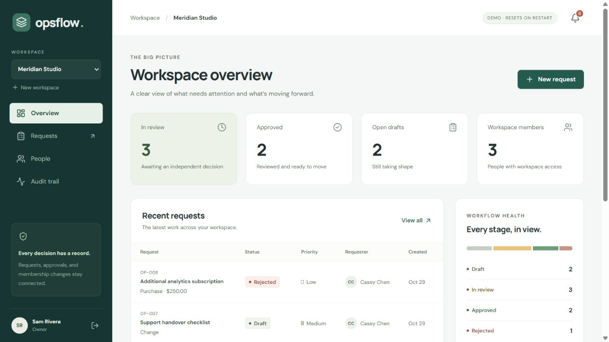
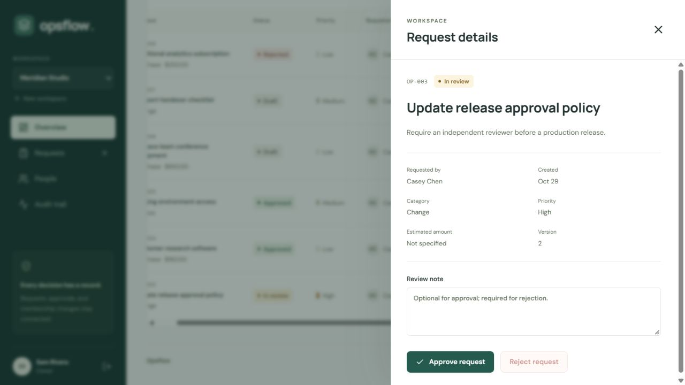
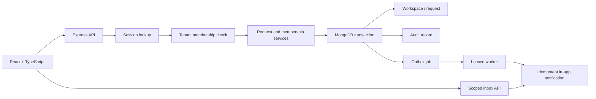

# Opsflow

[](https://github.com/the-devcraft/opsflow/actions/workflows/ci.yml)

An operations workspace for requests that need an independent decision.

A team member drafts a request, submits it, and gets a decision from another person. The request, decision, audit record, and queued notification stay consistent—even when two reviewers act at the same time or a worker stops halfway through delivery.

This is an original portfolio application, not a hosted production service. The implementation is intentionally focused: tenant boundaries and failure behavior get more attention than a long feature list.



## Try it locally

Requires **Node.js 24** and **pnpm 11.25.0**.

```sh
pnpm install --frozen-lockfile
pnpm build
pnpm demo
```

Open **http://127.0.0.1:4000**. Choose a demo persona, then sign in.

| Persona    | Email                   | Role            |
| ---------- | ----------------------- | --------------- |
| Sam Rivera | sam@meridian.example    | Workspace owner |
| Jordan Lee | jordan@meridian.example | Approver        |
| Casey Chen | casey@meridian.example  | Member          |

The shared demo password is `DemoAccount!2026`. These accounts are generated only by the local demo launcher. Production startup never creates them.

The demo starts a real, temporary MongoDB replica set. The first install downloads MongoDB from its official distribution server; it can take several minutes. Data resets when the demo exits. No cloud account, email provider, or personal credentials are needed. Use the numeric loopback address above so the browser origin matches the server configuration.

### A five-minute evaluation

1. Sign in as **Casey**. Create an access or purchase request, then submit the draft.
2. Open a separate private browser session and sign in as **Jordan**. Review the request and approve it, or reject it with a reason.
3. Return to Casey's inbox. The decision arrives through the outbox worker.
4. As **Sam**, inspect the audit trail and switch to **Northstar Labs**. It has its own empty request list.
5. Try approving your own request. The server refuses, regardless of your role.

## What is implemented

- Workspace membership and four roles: owner, admin, approver, member.
- Server-side tenant scoping for requests, memberships, audit records, and notifications.
- Draft → submitted → approved/rejected state machine with independent review.
- Optimistic concurrency: one of two conflicting decisions succeeds; the other receives a conflict.
- Idempotent request creation, scoped to the requester and workspace.
- MongoDB transactions covering domain changes, audit records, and outbox jobs.
- An at-least-once worker with leases, bounded retries, dead-lettering, and idempotent inbox delivery.
- Opaque, revocable sessions in HttpOnly cookies; scrypt password hashes; origin checks; validation and rate limits.
- Cursor pagination, literal title search, responsive layouts, keyboard-operated drawers, and explicit loading/error/empty states.



## Architecture



The application uses React, TypeScript, Express, and MongoDB. The same Express process serves the compiled UI in the production build, keeping browser requests on one origin. The demo and tests use the same API and service code as normal startup.

Read the [architecture and trade-offs](docs/architecture.md), [API reference](docs/api.md), and [security model](docs/security.md).

## Verify the project

```sh
pnpm check
pnpm exec playwright install chromium
pnpm test:e2e
```

The integration suite runs against an actual MongoDB replica set, not mocked repository functions. It covers authorization, cross-tenant object access, transaction rollback, concurrent state transitions, replayed creates, lease recovery, and duplicate notification delivery. Browser tests exercise two independent user sessions, workspace switching, mobile drawers, and account onboarding.

Coverage is generated in `coverage/`. Browser failure traces and screenshots are written to `test-results/`. Counts and results belong in the [verification record](docs/verification.md); the presence of tests does not imply there are no remaining defects.

GitHub Actions runs formatting, linting, type checking, integration tests, a production build, browser tests, a production dependency audit, and a Docker image build. Dependency updates are proposed by Dependabot.

## Development

```sh
# Temporary database, seeded accounts, and UI hot reload:
pnpm dev:demo

# Persistent replica set (configure .env first):
cp .env.example .env
pnpm dev
```

The development UI is at **http://127.0.0.1:5173**. The Vite server proxies `/api` to port 4000. Keep `APP_ORIGIN` aligned with the browser URL.

## Persistent local installation

```sh
docker compose up --build
```

The Compose file is a local integration setup: a single-node replica set, a persistent volume, and an app bound to `127.0.0.1:4000`. It is not a hardened production MongoDB deployment. Create an account and workspace through the UI; it does not seed demo accounts.

For production, supply an authenticated replica-set connection, an HTTPS `APP_ORIGIN`, and `NODE_ENV=production`. Put the service behind a TLS reverse proxy. See [deployment and operations](docs/operations.md) before exposing it publicly.

## Scope and limitations

This release does not include SSO, email verification/recovery, email delivery, billing, attachments, custom approval policies, ownership transfer, or immutable external audit storage. Draft contents are fixed after creation. See the [explicit limitations and next steps](docs/architecture.md#limitations-and-next-steps).

## Repository layout

```text
src/client/       React workspace UI and API client
src/server/       HTTP boundary, domain services, persistence, worker
src/shared/       Input schemas and response contracts
tests/            Replica-set integration and recovery tests
e2e/              Browser workflows
docs/             Architecture, security, API, operations, evidence
```

## Provenance

Opsflow was implemented for this portfolio. No source files from the reference projects were imported. Their problem-focused documentation informed the presentation approach; see [references and provenance](docs/provenance.md). External packages retain their own licenses.

Licensed under [MIT](LICENSE).
