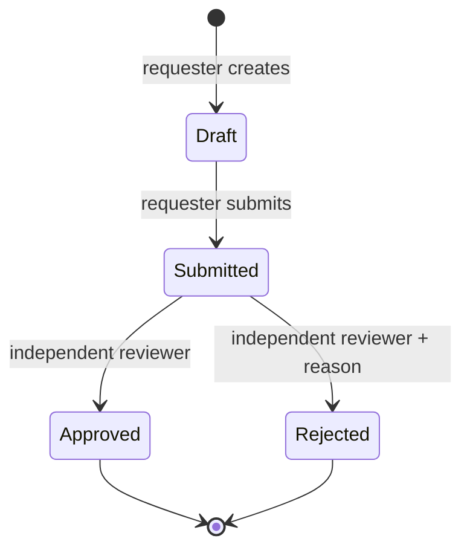

# Architecture and trade-offs

## The boundary that matters

An authenticated user is not automatically a member of a workspace. Every scoped route resolves the workspace identifier and looks up the user's current membership before reading data. Every entity lookup also includes `workspaceId`. Knowing a request or notification ID is insufficient to access it.

Unauthorized workspace lookups return 404, so the response does not distinguish an inaccessible workspace from a nonexistent one. Roles are read from the database on each request; they are never trusted from a browser token or request body. The integration suite includes a user who owns two workspaces to catch entity lookups that accidentally omit tenant scope.

## Why a modular monolith

The request lifecycle and authorization rules need to be understandable together. A single deployable service avoids distributed authorization, network transactions, and a message broker before they are justified. Domain operations live in `services.ts`; Express handles validation, authorization context, and response translation. MongoDB access is explicit rather than hidden behind a generic repository interface.

The worker is a separate module with a lease protocol. It currently runs in the API process, but multiple workers can safely compete for jobs. Extracting it into a separate process would not change the persistence contract.

## Request lifecycle

Only the author can submit. Owners, admins, and approvers can decide submitted requests, but none can review their own request. Resolved requests do not reopen. Every transition requires the version last seen by the client.

The update filter includes workspace, entity, state, and version. Concurrent decisions cannot both apply. The transaction callback may retry on a write conflict; on retry it observes the newer version and returns 409. MongoDB's replica-set transaction semantics are required, including during evaluation and testing.

## Atomic business changes

Each transition writes three things in one transaction:

1. The updated request and incremented version.
2. An audit record identifying the actor and action.
3. A notification job in the outbox.

Failure to write any part aborts the transaction. Request creation also updates the workspace sequence and writes its audit record atomically. Sequence values are per workspace, not global.

No external network call occurs inside a transaction. The email/user lookup during membership changes is a database lookup against already registered accounts.

## Idempotent creation

Clients send a high-entropy `Idempotency-Key`. A unique index scopes it to `(workspaceId, authorId, requestKey)`. The stored hash is computed from the validated, normalized request fields.

- Same key and same input: return the existing request.
- Same key and different input: 409.
- Concurrent same-key creates: one insertion, one sequence increment, one audit record.

This guarantee applies to request creation. Transitions use optimistic versions, not the same idempotency protocol. An uncertain transition result should be resolved by fetching the request again.

## Worker semantics

A worker atomically claims a ready job or an expired lease, sets a random lease token, and increments the attempt count. Leases last 30 seconds. Notification insertion uses a unique `(jobId, userId)` index and `$setOnInsert`, so recovery after partial delivery does not duplicate inbox records.

The lease token guards completion. A stale worker cannot mark a newer worker's lease complete. Delivery is **at least once**, with idempotent database effects; it is not a claim of exactly-once processing. There is no external email side effect in this release.

Failures back off exponentially, capped at 60 seconds. Jobs are dead-lettered after five claims. A crash on the fifth claim is also detected when its lease expires. Membership is checked before delivery so revoked users are skipped. See the security model for the remaining concurrency boundary around revocation.

## Data and indexes

| Collection    | Purpose                                 | Important index                                                           |
| ------------- | --------------------------------------- | ------------------------------------------------------------------------- |
| users         | Account identity and password hash      | unique email                                                              |
| sessions      | Revocable opaque sessions               | unique token hash; TTL expiry                                             |
| workspaces    | Tenant and request sequence             | primary key                                                               |
| memberships   | User role within a tenant               | unique workspace + user; user lookup                                      |
| requests      | Workflow state and creation replay data | unique tenant + number; tenant + author + replay key; tenant + state + ID |
| audit         | Actor, entity, action, and detail       | tenant + descending ID                                                    |
| jobs          | Outbox payload and lease                | state + availability + lease expiry                                       |
| notifications | Recipient inbox                         | unique job + recipient; tenant + recipient + descending ID                |

Lists use bounded, descending ObjectId cursors. This is insertion-identifier order, not a global ordering guarantee across concurrent transactions. The UI shows timestamps separately. Literal title search uses an escaped expression and a bounded input length; very large tenants would need dedicated search indexing.

## Limitations and next steps

- No email verification, recovery, MFA, or SSO. These are prerequisites for a serious public deployment.
- Registration is open. Membership is added by a known registered email; this is not a full invitation lifecycle.
- Roles are checked at request entry. Revocation does not cancel an already executing request. Inbox delivery rechecks membership, but a concurrent revocation can race with an insertion; the revoked user still cannot read the tenant API afterward.
- The workspace owner is fixed. Ownership transfer requires a separate, reviewed protocol.
- Draft fields are not editable after creation, and resolved requests cannot reopen. A revision workflow would need explicit state and audit rules.
- In-app notifications only. External providers need delivery receipts, secret handling, and provider-specific idempotency.
- Single-region deployment, no load/performance claim. The rate limiter is in process; horizontal deployment needs a shared store and trusted proxy configuration.
- Audit records are append-only through the API, not cryptographically immutable or protected from database administrators. Export to external retention storage would be the next audit-hardening step.
- No operational UI for replaying dead-lettered jobs. Inspection and controlled replay are described in operations notes.
- No assertion that this portfolio application is production-ready or defect-free. The verified scope and remaining risks are explicit.
